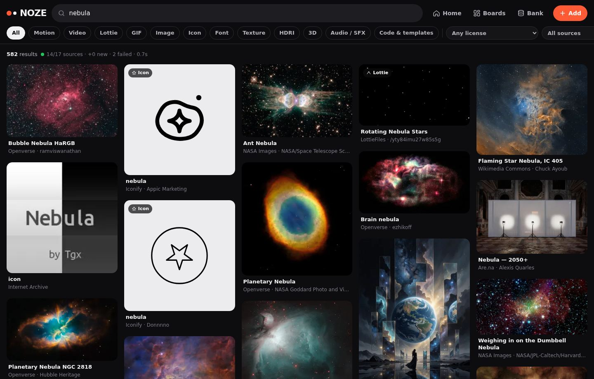
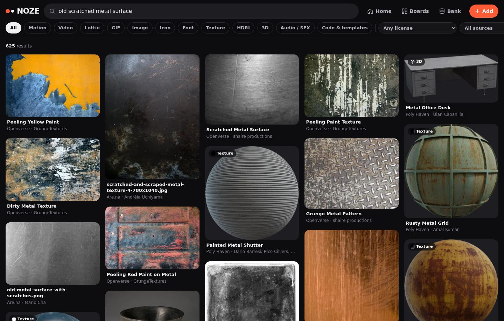
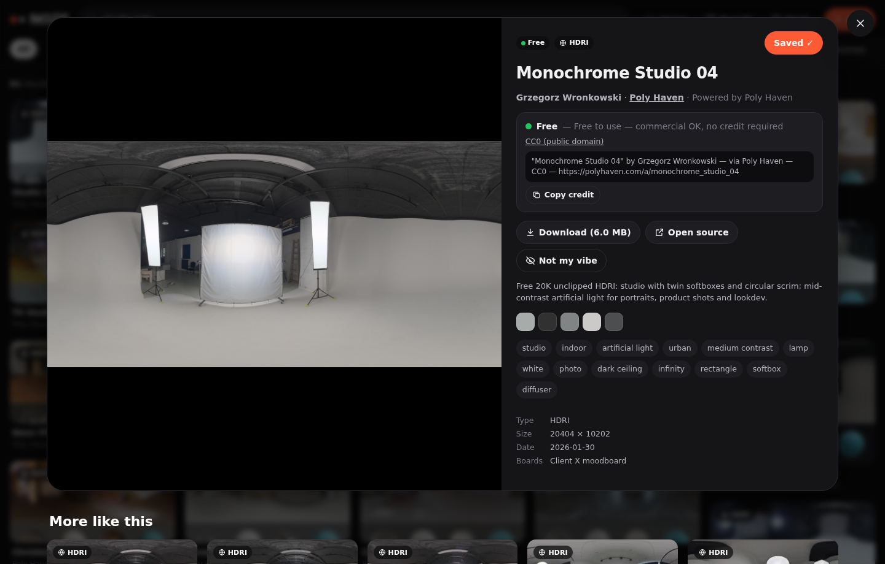

# NOZE — bank aset kreatif pribadi

Satu tempat buat nyari **referensi & aset** (motion, video, Lottie, GIF, gambar, ikon, font, tekstur PBR, HDRI, 3D, SFX, kode/template) dari **puluhan sumber kreatif sekaligus**, nyambung-nyambungin yang "se-vibe" kayak Pinterest, dan **nyimpen semuanya jadi bank milikmu sendiri** — jadi nggak perlu nyari/crawl ulang.



## Yang bisa dilakukan

- **Sekali cari, 29 sumber** (18 langsung jalan tanpa API key): Openverse (800 jt+ media CC), Wallhaven, Wikimedia Commons, Poly Haven, ambientCG, NASA, The Met, Art Institute of Chicago, Cleveland Museum, Smithsonian, Europeana, Internet Archive, Iconify, Fontsource, GitHub, Are.na, LottieFiles, Civitai (hasil AI publik) — plus Pexels, Pixabay, Unsplash, Tumblr, Flickr, DeviantArt, Vimeo, YouTube, Freesound, GIPHY, Reddit kalau kamu isi API key gratisnya. Daftar lengkap: [docs/SOURCES.md](docs/SOURCES.md).
- **Ngerti vibe, bukan cuma kata kunci.** Dengan CLIP, "old scratched metal surface" nemu tekstur karat & logam baret walau judulnya nggak nyebut itu. Ketik pakai **bahasa Indonesia** juga bisa: "hujan malam kota neon video gratis" → dicari sebagai *rain night city neon*, otomatis filter video & lisensi aman.
- **"More like this" ala Pinterest**: gabungan kemiripan visual, board yang sering barengan (punyamu + channel Are.na), tag, palet warna, dan kreator yang sama.
- **Feed "For you"** yang belajar dari yang kamu buka, simpan, download, dan "Not my vibe".
- **Label lisensi di setiap aset** — jawaban "bisa dipake nggak?": `Free` (komersial OK tanpa kredit) · `Credit` (wajib kredit) · `Non-comm.` · `Ref only` (cuma referensi) · `Check` (cek dulu) · `Mine`. Filter "Usable commercially" tinggal klik.
- **Board + bank**: tekan *Save* → file aslinya otomatis di-download ke bank (dedup pakai SHA-256). *Export pack* → zip berisi semua file + `CREDITS.txt` yang sudah dikelompokkan per lisensi.
- **Mode Inspiration** (default): hasil pencarian fokus ke visual (gambar, video, GIF, link, tekstur). Ikon/font/Lottie/SFX/kode cuma muncul kalau kamu minta ("font retro", "whoosh sfx") atau pilih chip-nya. Hasil yang cuma nyerempet satu kata dibuang.
- **Pinterest lewat bookmarklet**: buka Pinterest seperti biasa → klik "Save to NOZE" → *Select all* → semua pin yang kamu lihat (versi 736px + link pin) masuk bank sekaligus, dan saling terhubung untuk "More like this". Berlaku juga buat Behance, Dribbble, X, galeri AI (Dreamina/Higgsfield/Kling). Detail: [docs/SOURCES.md](docs/SOURCES.md#pinterest).
- **Pinterest otomatis**: klik *Connect Pinterest* sekali di halaman Bank → semua board & pin **milikmu** ikut masuk dan di-sync sendiri tiap 6 jam (API resmi, token diperpanjang otomatis). Kamu tinggal save pin di Pinterest kayak biasa — dari HP juga bisa.
- **Autopilot (default nyala)**: bank langsung ngisi sendiri dari *starter pack* 50 topik motion/design pas pertama jalan; yang kamu cari 2× atau kamu save dari pencarian, plus nama tiap board Pinterest-mu, otomatis jadi "interest" yang di-crawl di background makin dalam tiap putaran. Hapus interest → nggak dipelajari lagi. Matikan: `NOZE_AUTOPILOT=0`.
- **API key ditempel di web**, nggak perlu edit file: halaman Bank → *Sources* → paste key → sumbernya langsung nyala.
- **Import** folder aset lama (`noze import-folder`).
- **Generate yang nggak ketemu** (opsional): Seedance (video) / FLUX (gambar) via Replicate, hasilnya masuk bank sebagai asetmu.

| Vibe search | Detail + lisensi + "More like this" |
|---|---|
|  |  |

## Mulai

Butuh Python 3.10+.

```bash
git clone https://github.com/nozeoz/noze.git && cd noze
python -m venv .venv && source .venv/bin/activate      # Windows: .venv\Scripts\activate
pip install -e ".[clip]"      # dengan CLIP (vibe search beneran, ±600 MB model diunduh sekali)
# pip install -e .            # versi ringan tanpa ML (keyword + warna)
noze serve
```

Buka **http://localhost:8787**, ketik vibe apa aja. Hasil dari sumber langsung disimpan ke bank (metadata + thumbnail kecil), jadi pencarian berikutnya instan & bisa offline.

Pakai Docker: `cp .env.example .env && docker compose up -d`.

API key (opsional) bisa ditempel langsung di halaman **Bank**, atau ditulis di `.env` — lihat [.env.example](.env.example). Mau dibuka dari HP? Jalankan `noze serve --host 0.0.0.0` **dengan** `NOZE_PASSWORD` di-set (atau pakai Tailscale).

## Soal Pinterest & "free"

Konten Pinterest **bukan** otomatis bebas pakai: kebanyakan pin adalah repost karya orang lain, hak ciptanya tetap milik kreator aslinya, dan ToS Pinterest melarang scraping. Pinterest juga nggak punya API pencarian publik — API resminya cuma bisa baca board milikmu sendiri. Jadi NOZE sengaja:

1. narik dari sumber yang **lisensinya jelas** (CC0, public domain, Pexels/Unsplash/Pixabay License, CC BY, OFL, MIT, Lottie Simple License…), dengan label per aset;
2. nyimpen **referensi dari situs mana pun** lewat bookmarklet — kamu yang milih, kayak nekan "Save" — ditandai `Ref only`;
3. nge-sync **board Pinterest milikmu** otomatis lewat API resmi, juga sebagai referensi.

Hasil AI publik (Civitai) dilabeli `Check`: status hak ciptanya belum jelas dan tergantung aturan platform.

## Cara kerjanya (singkat)

```
cari "hujan malam neon"
   │  terjemahan + intent (kind/lisensi/warna) + saran vibe
   ▼
fan-out ke semua sumber yang relevan (paralel, rate-limit, cache 7 hari)
   ▼
normalisasi → 1 skema aset (lisensi → kelas pemakaian) → SQLite + FTS5
   ▼
worker background: cache thumbnail (WebP ±14 KB), palet warna, dHash, vektor CLIP
   ▼
ranking hybrid: relevansi versi sumber + BM25 + vektor vibe  →  RRF
   + boost selera kamu, warna, popularitas  →  MMR biar beragam
```

Penjelasan lengkap — termasuk gimana sistem "related" Pinterest bekerja (graf pin–board, PinSage, embedding visual, sinyal personal) dan padanannya di NOZE: [docs/ARCHITECTURE.md](docs/ARCHITECTURE.md).

## Storage

Bank dibuat bertingkat supaya hemat:

- **Semua hasil pencarian**: metadata + thumbnail saja (terukur ±18 KB per aset → 100 ribu aset ≈ 1,8 GB).
- **File asli**: hanya yang kamu *Save*/*Download* (dedup otomatis).
- Simpan di disk lokal/HDD eksternal/NAS (`NOZE_DATA_DIR`), atau bucket S3-compatible: **Cloudflare R2** (10 GB gratis, tanpa biaya egress), Backblaze B2, Wasabi, MinIO. Sinkron ke Google Drive dll. bisa lewat rclone.

Perbandingan opsi, estimasi biaya, dan cara setup: [docs/STORAGE.md](docs/STORAGE.md).

## Perintah CLI

| Perintah | Fungsi |
|---|---|
| `noze serve [--host --port --no-worker]` | jalankan web app + worker background |
| `noze harvest "film burn" --kinds video --pages 3` | crawl satu topik ke bank |
| `noze starter` | isi bank dengan ±50 topik motion/design |
| `noze search "y2k chrome" [--live]` | cari dari terminal |
| `noze sources` | status semua sumber + key yang kurang |
| `noze import-folder ~/Assets --board "Old packs" [--link]` | indeks folder aset lama (nama folder jadi tag) |
| `noze import-pinterest` | impor board Pinterest milikmu sekali jalan (biasanya nggak perlu: *Connect Pinterest* di web sudah sync otomatis) |
| `noze save <url> --board Refs` | simpan link/gambar/video dari web |
| `noze export-board "Client X" pack.zip` | zip + CREDITS.txt |
| `noze enrich` / `noze reindex` | proses thumbnail & vektor sekarang / hitung ulang setelah pasang CLIP |
| `noze stats` | isi bank & pemakaian storage |

## Develop

```bash
pip install -e ".[dev]"
pytest            # tiap konektor diuji dengan bentuk respons API aslinya (tanpa jaringan)
```

Struktur: `noze/sources/` (satu file per sumber — nambah sumber baru cukup satu class, lihat [docs/SOURCES.md](docs/SOURCES.md#nambah-sumber-baru)), `noze/harvest.py` (fan-out + cache), `noze/search.py` (ranking), `noze/enrich.py` (thumbnail/warna/vektor), `noze/api.py` + `noze/web/` (UI tanpa build step), `noze/importers/`.

Pemutar Lottie di `noze/web/vendor/` adalah lottie-web © Airbnb (lisensi MIT, disertakan).
